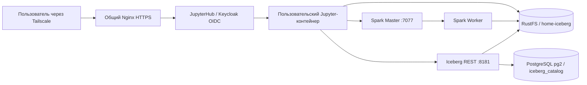

# Homelab Sparkice — Spark, Iceberg и JupyterHub

Одноузловая платформа Data Engineering на домашнем HP-сервере (Ubuntu 24.04, Docker Compose): **Apache Spark Standalone 3.5.5**, **Apache Iceberg**, **JupyterHub 5.3**, объектное хранилище S3-совместимого типа и единая авторизация через Keycloak.

Рабочий адрес: **https://jupyter.handyman.moscow** (через Tailscale и существующий Nginx).

Проект нужен для прототипирования ETL/ELT, работы с DataFrame и PySpark, экспериментов с Iceberg-таблицами, тестирования связки Spark → Iceberg → S3 и подготовки портфолио. Он дополняет [базовый Outline-стек](https://github.com/glazole/outline_wiki), [Airflow](https://github.com/glazole/homelab-airflow) и [аналитический контур PostgreSQL / ClickHouse / Metabase](https://github.com/glazole/homelab-analytics-stack).

> Это **single-host homelab**, не отказоустойчивый production-кластер. Имена контейнеров и Docker-сети рассчитаны на уже существующую инфраструктуру HP-сервера; этот репозиторий не разворачивает заново PostgreSQL, Keycloak, RustFS или Nginx.

## 1. Назначение компонентов

| Компонент | Версия/образ | Назначение |
|---|---|---|
| Spark Master | Spark 3.5.5, локальная сборка | Координирует Spark-приложения, RPC `spark-master:7077` |
| Spark Worker | Spark 3.5.5, notebook-образ | Выполняет задания, 3 ядра / 4 GiB объявленной памяти |
| Iceberg REST Catalog | `tabulario/iceberg-rest:1.6.0` | Каталог Iceberg с JDBC-бэкендом в PostgreSQL |
| JupyterHub | Локальный образ на JupyterHub 5.3 | Аутентификация через Keycloak и запуск пользовательских контейнеров |
| Jupyter single-user | `handyman-jupyter-spark:3.5.5-ice161` | JupyterLab, PySpark Driver, доступ к Spark, Iceberg и RustFS |
| RustFS — существующий | `rustfs:9000` | S3-хранилище данных и файлов таблиц Iceberg |
| PostgreSQL pg2 — существующий | `pg2:5432 / iceberg_catalog` | Метаданные каталога Iceberg |
| Nginx/Keycloak — существующие | `homelab-nginx` / OIDC | HTTPS и единый вход |

Согласно Dockerfile и Compose, runtime Iceberg для Spark — **1.6.1**, REST-контейнер — **1.6.0**. Их совместимость следует проверять при обновлении.

### Схема



Используются две **внешние** сети Docker:

- `outline-network` — Spark, JupyterHub, пользовательские контейнеры, Iceberg REST, общий Nginx и RustFS;
- `homelab-db` — **Iceberg REST** → `pg2`.

В Compose **нет опубликованных наружу портов** Spark RPC, Spark UI и каталога. Снаружи через Nginx доступен только пользовательский интерфейс JupyterHub.

## 2. Структура репозитория

```text
homelab-sparkice/
├── README.md
├── docker-compose.yml
├── .env.example
├── .gitignore
├── .dockerignore
├── prepare.sh
├── init-db.sh
├── start.sh
├── stop.sh
├── status.sh
├── check.sh
├── install-nginx.sh
├── conf/spark/spark-defaults.conf
├── docker/
│   ├── spark/Dockerfile
│   ├── spark/download-jars.sh
│   ├── spark/requirements-notebook.txt
│   └── jupyterhub/Dockerfile
├── jupyterhub/jupyterhub_config.py
├── nginx/jupyterhub.conf
├── spark-ui-startup.py
└── notebooks/01_smoke_test.ipynb
```

Локальные `.env`, `certs/`, volumes и пользовательские блокноты/данные не должны попадать в Git.

## 3. Предварительные требования

На сервере:

1. Docker Engine + Docker Compose v2, `openssl`, `python3`, `curl` на хосте для диагностики;
2. работающие сети `outline-network` и `homelab-db`;
3. PostgreSQL-контейнер `pg2` с **уже существующей** базой `iceberg_catalog`;
4. существующие Keycloak, RustFS и Nginx из проекта `outline_wiki`;
5. доверенный корневой CA для `https://keycloak.handyman.moscow` (при использовании собственного CA);
6. в RustFS **вручную созданный** bucket `home-iceberg` с отдельными S3-учётными данными;
7. локальное разрешение домена `jupyter.handyman.moscow` на адрес HP-сервера (в действующем стенде — Tailscale + dnsmasq).

Проверить зависимости:

```bash
docker compose version
docker network inspect outline-network >/dev/null
docker network inspect homelab-db >/dev/null
docker inspect pg2 --format '{{.State.Health.Status}}'
docker ps --format 'table {{.Names}}\t{{.Status}}'
tailscale ip -4
```

Код предполагает каталог **`~/projects/homelab/sparkice`**: таковы относительные пути к `../outline_wiki` в скриптах. С GitHub можно клонировать с указанием локального имени:

```bash
cd ~/projects/homelab
git clone git@github.com:glazole/homelab-sparkice.git sparkice
cd sparkice
chmod +x ./*.sh
```

Если папка уже развёрнута, **не клонируй поверх неё**: прежде посмотри `git status` и синхронизируй существующий checkout.

## 4. Последовательное развёртывание

### Шаг 1. Подготовить окружение и CA

```bash
cd ~/projects/homelab/sparkice
./prepare.sh
nano .env
```

`prepare.sh` создаёт `.env` из `.env.example`, если тот отсутствует, генерирует `ICEBERG_DB_PASSWORD` и формирует `certs/ca-bundle.pem` из системных сертификатов и `../outline_wiki/nginx/certs/rootCA.pem`. Повторный вызов **не перезаписывает** `.env`.

В `.env` заполнить:

| Переменная | Что указать |
|---|---|
| `KEYCLOAK_ISSUER` | `https://keycloak.handyman.moscow/realms/<REALM>` |
| `KEYCLOAK_CLIENT_ID` | `jupyterhub` |
| `KEYCLOAK_CLIENT_SECRET` | Секрет клиента из действующего Keycloak |
| `JUPYTERHUB_ALLOWED_USERS` | Список реальных `preferred_username`, через запятую |
| `JUPYTERHUB_ADMIN_USERS` | Администраторы Hub, если требуются |
| `RUSTFS_ACCESS_KEY_ID` | Отдельный S3 Access Key для `home-iceberg` |
| `RUSTFS_SECRET_ACCESS_KEY` | Соответствующий Secret Key |
| `ICEBERG_BUCKET` | Обычно `home-iceberg` |
| `ICEBERG_DB_PASSWORD` | Уже сгенерирован `prepare.sh` |

Плейсхолдеры `REPLACE_*` заставят `start.sh` остановиться. Пароли и ключи не публикуются в репозитории.

### Шаг 2. Создать клиент OIDC в существующем Keycloak

В **https://keycloak.handyman.moscow** использовать **существующий realm**, не создавать второй Keycloak.

| Параметр клиента | Значение |
|---|---|
| Client ID | `jupyterhub` |
| Client type | OpenID Connect |
| Client authentication | ON (confidential client) |
| Standard flow | ON |
| Redirect URI | `https://jupyter.handyman.moscow/hub/oauth_callback` |
| Web origins | `https://jupyter.handyman.moscow` |

Secret клиента записать только в `.env`. Доступ задаётся списком `JUPYTERHUB_ALLOWED_USERS`; конфигурация явно отключает `allow_all`. Для подключения нового пользователя добавь его `preferred_username` и перезапусти JupyterHub.

**Примечание:** в конфигурации `JupyterHub` для DockerSpawner смонтирован `/var/run/docker.sock`. Это фактически доступ с высокими привилегиями к хосту; неизвестным пользователям такой Hub предоставлять нельзя.

### Шаг 3. Подготовить PostgreSQL pg2

```bash
cd ~/projects/homelab/sparkice
./init-db.sh
```

Скрипт **не создаёт pg2 или БД `iceberg_catalog`**. Он проверяет существующий `pg2`, создаёт (или обновляет) роль `iceberg_app` и выдаёт ей `CONNECT`, `USAGE`, `CREATE` для каталога в pg2. Операции pg1/pg3 не затрагиваются.

**Важно:** при повторном запуске `init-db.sh` устанавливает пароль роли `iceberg_app` из текущего `.env`; не регенерируй его отдельно без согласованного обновления контейнера Iceberg REST.

### Шаг 4. Создать bucket RustFS

В консоли **https://rustfs.handyman.moscow** создать bucket `home-iceberg`, если его ещё нет. Настроить отдельную S3-учётную запись с минимально необходимыми правами. Endpoint в контейнерах — `http://rustfs:9000`, warehouse каталога — `s3://home-iceberg/warehouse/` (или bucket, указанный в `.env`).

RustFS и Keycloak уже используются другими сервисами; повторные экземпляры не создаются.

### Шаг 5. Собрать образы и запустить сервисы

```bash
cd ~/projects/homelab/sparkice
./start.sh
```

Фактическая последовательность `start.sh`:

1. проверка CA, обязательных параметров `.env` и Docker-сетей;
2. повторный вызов `init-db.sh`;
3. сборка Spark base;
4. сборка notebook-образа с использованием профиля `images`;
5. сборка JupyterHub;
6. `docker compose up -d spark-master spark-worker iceberg-rest jupyterhub`.

Скрипт **пересобирает образы на каждом запуске**, поэтому при обычном повторном старте без изменений можно воспользоваться:

```bash
docker compose up -d spark-master spark-worker iceberg-rest jupyterhub
```

### Шаг 6. Проверить внутренние компоненты

```bash
./status.sh
./check.sh
docker compose ps
```

`check.sh` проверяет доступность Iceberg REST и Spark Master через контейнеры. Если используемой версии образа не хватает `curl` / `wget`, диагностический скрипт может потребовать адаптации: ошибка отсутствия утилиты **не обязательно** означает отказ Spark или Iceberg.

Ручные проверки:

```bash
docker compose logs --tail=100 spark-master
docker compose logs --tail=100 spark-worker
docker compose logs --tail=100 iceberg-rest
docker compose logs --tail=100 jupyterhub
```

Проверить, что Spark Worker подключился к Spark Master, а Iceberg REST получил соединение с pg2.

### Шаг 7. Подключить HTTPS

Сначала убедиться, что **`homelab-nginx` запущен**, сертификат доверенный, а для `jupyter.handyman.moscow` настроен DNS через Tailscale.

```bash
cd ~/projects/homelab/sparkice
./install-nginx.sh

docker exec homelab-nginx nginx -t
docker exec homelab-nginx getent hosts jupyterhub
```

Скрипт копирует `nginx/jupyterhub.conf` в `../outline_wiki/nginx/conf.d/jupyterhub.conf` и выполняет reload существующего Nginx. **Не создавай дублирующий server block**, если он уже настроен в Outline.

Открыть **https://jupyter.handyman.moscow**. После перенаправления в Keycloak пройти аутентификацию: JupyterHub запустит пользовательский контейнер `sparkice-jupyter-<username>` с рабочим каталогом `/home/spark/work`.

## 5. Проверка Spark и Iceberg в Jupyter

В JupyterLab открыть `notebooks/01_smoke_test.ipynb` (файл репозитория) или перенести его ячейки в рабочий блокнот.

Тесты затрагивают:

- связь с Spark Master/Worker;
- `spark.range(100).count()` → `100`;
- видимость S3 bucket в RustFS;
- создание Iceberg namespace и таблицы через REST/JDBC, запись и чтение;
- Parquet через S3A.

**Осторожно:** smoke notebook при повторном запуске может дописывать строки в тестовую Iceberg-таблицу, поэтому ожидаемые counts зависят от числа запусков.

Для быстрой вычислительной проверки, не создающей таблиц:

```python
from pyspark.sql import functions as F
import time

started = time.perf_counter()
groups = spark.range(5_000_000).groupBy((F.col("id") % 100).alias("bucket")).count()
print("Количество групп:", groups.count())
print("Секунды:", round(time.perf_counter() - started, 2))
```

Этот тест показывает работу вычислительного контура, но **не заменяет** проверку записи в Iceberg/RustFS. На HP-сервере также выполнялся более крупный Spark `range` + `groupBy` тест; его показатели не следует переносить на реальные широкие таблицы, shuffle-heavy join и загрузки данных.

## 6. Использование памяти

Текущий бюджет в конфигурации:

| Ресурс | Ограничение |
|---|---|
| Spark Worker | 3 CPU cores / 4 GiB Spark memory advertised |
| Docker memory limit Worker | 5 GiB |
| Jupyter single-user | 3 GiB на контейнер |
| PySpark Driver / Spark | `spark.cores.max=2`, `executor.cores=2`, `executor.memory=2g` |

Выполняй одну тяжёлую сессию за раз, пока не измерены одновременные нагрузки. **Объявленные лимиты — не резервирование RAM.**

```bash
free -h
docker stats --no-stream \
  --format 'table {{.Name}}\t{{.MemUsage}}\t{{.CPUPerc}}'
swapon --show
```

Пользовательские Jupyter-контейнеры создаются по запросу, в отличие от постоянно работающего JupyterHub. Не забывай завершать ненужные пользовательские сессии, освобождая память.

## 7. Остановка и данные

```bash
cd ~/projects/homelab/sparkice
./stop.sh
docker compose ps -a
```

Остановка проекта не должна затронуть общие Nginx, Keycloak, RustFS и PostgreSQL, но перед обслуживанием убедись, что нет активных Jupyter/Spark-заданий.

Хранение состояния:

- `homelab-sparkice_jupyterhub-data` — состояние JupyterHub;
- `sparkice-notebooks-<username>` — пользовательские блокноты;
- `pg2.iceberg_catalog` — метаданные каталога Iceberg;
- `RustFS / home-iceberg` — физические данные таблиц;
- временные Spark-данные — отдельные volumes.

**Важно:** резервирование только `pg2` или только RustFS не обеспечивает полноценное восстановление Iceberg: метаданные и объекты должны быть согласованными. Не выполнять `docker compose down -v` для обычной остановки.

## 8. Безопасность и диагностика

| Симптом | Что проверить |
|---|---|
| `Fill KEYCLOAK_* / RUSTFS_*` | Значения из `.env`, отсутствие placeholders |
| `pg2 not ready` | БД `iceberg_catalog`, сеть `homelab-db`, статус `pg2` |
| HTTP 502 на JupyterHub | `docker compose logs jupyterhub`, Docker DNS и `nginx -t` |
| Ошибка авторизации Keycloak | OIDC realm, redirect URI, secret, CA, allowed `preferred_username` |
| Spark Worker отсутствует в Master | `docker compose logs spark-worker`, адрес `spark://spark-master:7077` |
| Ошибка Iceberg REST | пароль `iceberg_app`, JDBC `pg2:5432`, bucket/endpoint RustFS |
| S3 `AccessDenied` | IAM/policy ключей `home-iceberg` и наличие bucket |
| Отсутствует notebook image | `docker compose --profile images build jupyter-image` |

Не отключай проверку TLS ради устранения OIDC-ошибок. Сохраняй секреты, файлы CA, volumes и копии данных **вне Git**. Используемый REST-образ `tabulario/iceberg-rest:1.6.0` является reference/test-компонентом, а не полноценной промышленной инсталляцией.

**Статус:** основная Spark/Jupyter-инфраструктура реально запускалась на HP-сервере, но корректное восстановление из бэкапов и полный E2E smoke test Iceberg после каждого изменения версии требуют отдельной проверки.

---

Связанные проекты: [outline_wiki](https://github.com/glazole/outline_wiki) · [homelab-airflow](https://github.com/glazole/homelab-airflow) · [homelab-analytics-stack](https://github.com/glazole/homelab-analytics-stack).
